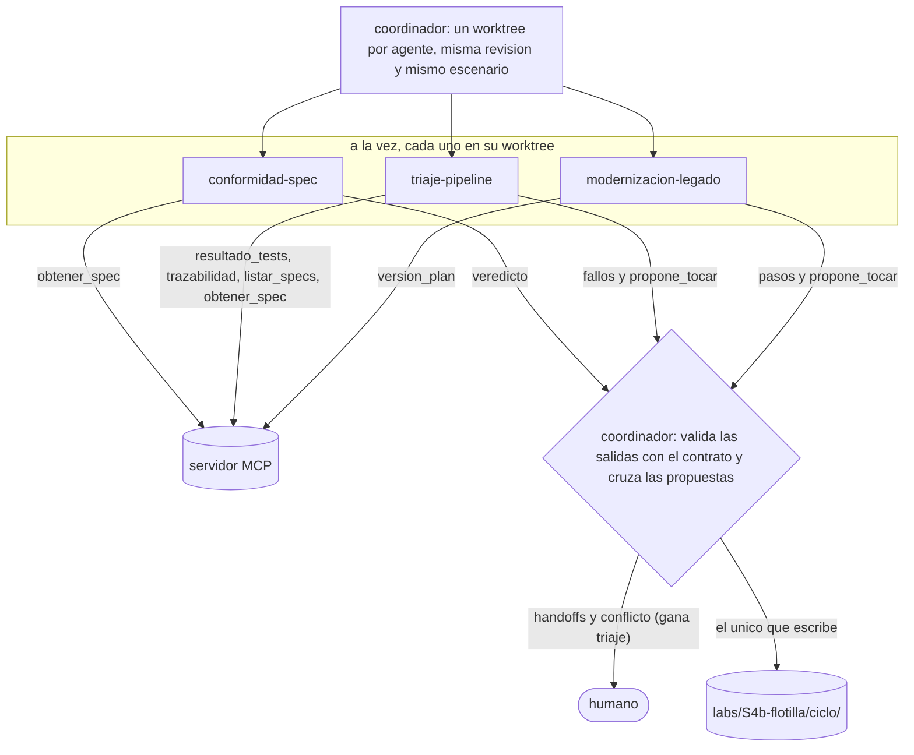

# Bitacora de S4b

Registra coordinacion, handoffs, conflictos y evidencia de ejecucion.

## AVISO PARA S5: el verificador de la regla dura solo lee el titulo de los commits

En S5, el criterio S5-02 ("la caracterizacion precede al refactor en el historial") fallara
aunque el codigo heredado no se haya tocado, y `aula cerrar S5` no sella con un criterio en rojo.

**Por que.** El commit `3c6b882` de S3 se titulo "refactor: unificar creditos_superados en
media.py". Cambio `motor.py` y dos specs; **no toco `src/aula/legado/`**. Pero el verificador solo
mira el titulo.

**Como valida exactamente.** `labs/S5-legado/verificar.py` llama a
`orden_en_historial(r"caracteriz", r"^refactor", por_asunto=True)` (`aula_cli/verificacion.py`):

1. Recorre `git log --reverse` del mas antiguo al mas nuevo.
2. Solo mira el titulo de cada commit, no los ficheros que cambia.
3. Busca el primer titulo que contiene "caracteriz" y el primero que empieza por "refactor".
4. Pasa si el de caracterizacion va antes, o si no hay ningun refactor.

El primer titulo con "refactor" es el commit 24 del historial (`3c6b882`), y todavia no hay ninguno
con "caracteriz": cualquier caracterizacion que se haga en S5 ira detras. **Hay que contarselo al
mentor.** Reescribir ese titulo en main seria maquillar el historial, y no se hace. En S4b ningun
commit empieza por "refactor" ni menciona la caracterizacion.

## Como se trabajo

En solitario, por instruccion del tutor: la escuadra no participo en la construccion.

## Diseno

- **El contrato primero.** `agentes/flotilla/contrato.json` dice que ve cada agente (herramientas
  MCP y entradas), que devuelve, que no escribe nada, que llega al humano y que pasa en un
  conflicto. Se valida con `python -m agentes.flotilla.contrato` y en el pipeline, donde un test
  comprueba ademas que el codigo de cada agente usa justo las herramientas que declara.
- **Agentes deterministas, sin modelo**, como conformidad: reglas fijas, reproducibles.
- **Paralelo para leer, secuencial para decidir.** Ningun agente usa la salida de otro, asi que
  se lanzan a la vez, cada uno en su worktree. El coordinador decide despues, y es el unico que
  escribe.
- **Prioridad en un conflicto: triaje antes que modernizacion**, porque primero hay que devolver
  el verde. Del que pierde solo se pospone ese fichero.
- **Worktrees fuera de OneDrive** (`~/aula-flotilla/`): OneDrive bloquea los ficheros de git y no
  deja borrar los restos de `.git/worktrees/`.

## Diagrama de flotilla

La explicacion completa esta en `labs/S4b-flotilla/flotilla.md`.

## Ciclo grabado

`labs/S4b-flotilla/ciclo/` (`ciclo.jsonl` y `ciclo.md`). Escenario: un parche que redondea la nota
de cada asignatura en `media.py`, contra el invariante 1.

| Agente | Resultado |
|---|---|
| conformidad | no conforme: CA-04 sin test |
| triaje | rojo: 2 tests de CA-04 fallan, regresion, sospechoso `src/aula/reglas/media.py` |
| modernizacion | legado sin caracterizar, coma flotante, redondeo dentro de un bucle (tambien en `media.py`) y `MAX_CONV = 6`, que repite `max_convocatorias` del plan |

- Los tres empezaron antes de que acabara ninguno: se ejecutaron a la vez.
- **Conflicto** sobre `src/aula/reglas/media.py`: lo proponen triaje y modernizacion; gana triaje y
  se pospone la propuesta de modernizacion sobre ese fichero.
- `git worktree list` muestra los tres worktrees de la flotilla, uno por agente.
