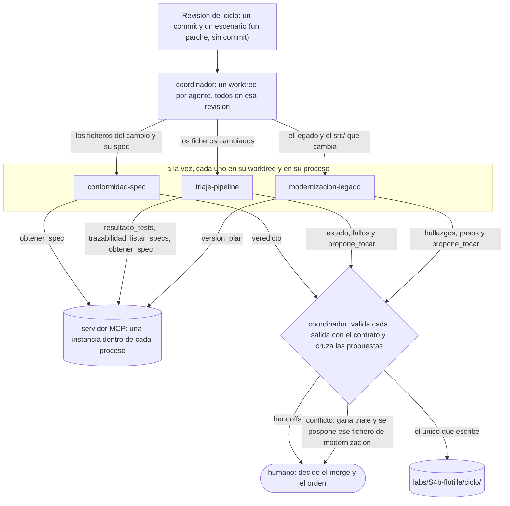

# Flotilla de S4b

Tres agentes trabajan sobre el mismo servidor MCP (`agentes/mcp_aula/servidor.py`):
conformidad, triaje de pipeline y propuesta de modernizacion. La fuente de verdad es el
contrato `agentes/flotilla/contrato.json`; este documento lo explica y lo dibuja.

## Diagrama



## Que ve cada agente y que escribe

| Agente | Herramientas MCP | Entrada | Salida (JSON) | Escribe |
|---|---|---|---|---|
| `conformidad-spec` | `obtener_spec` | los ficheros del cambio, los criterios que declara y su spec | veredicto, criterios sin cubrir, fuera de alcance | nada |
| `triaje-pipeline` | `resultado_tests`, `trazabilidad`, `listar_specs`, `obtener_spec` | los tests y los ficheros cambiados | estado (verde, rojo o no ejecutado), fallos clasificados con su criterio, `propone_tocar` | nada |
| `modernizacion-legado` | `version_plan` | el legado y el codigo de `src/` que cambia | hallazgos, pasos en orden (caracterizar primero), `propone_tocar` | nada |

Ningun agente escribe ficheros: solo imprimen su salida. El unico que escribe es el coordinador,
y solo en `labs/S4b-flotilla/ciclo/`.

Triaje y modernizacion piden las herramientas a traves de `agentes/flotilla/mcp.py`, que rechaza
las que su contrato no declara. Ningun agente usa la salida de otro, por eso pueden ir a la vez.

## Que se pasan (handoff)

Todo llega al humano, a traves del coordinador:

| De | Cuando | Que pasa |
|---|---|---|
| conformidad | siempre | el veredicto, para decidir el merge |
| triaje | si el estado es rojo o no ejecutado | cada fallo con su categoria, su criterio y los ficheros que mirar |
| modernizacion | siempre | la propuesta por pasos; ningun paso se aplica sin aprobacion humana |

## Que pasa cuando dos quieren tocar el mismo fichero

1. El coordinador cruza los `propone_tocar` de las salidas. Conformidad no propone cambios.
2. Si dos agentes proponen el mismo fichero, gana el de mas prioridad: **triaje, y despues
   modernizacion**, porque primero hay que devolver el verde.
3. Del que pierde solo se pospone la propuesta sobre ese fichero; el resto sigue adelante.
4. Ningun agente aplica nada. Si la propuesta toca una ruta protegida de CLAUDE.md, o hay una
   duda que la prioridad no resuelve, decide el humano.
5. En git: los agentes no crean ramas ni commits. Si dos propuestas se convierten en PRs, se
   mergea primero la del agente con mas prioridad y la otra se rehace sobre main.

Si un agente falla (no acaba, no devuelve JSON o le falta un campo de su salida), el ciclo queda
incompleto y no se decide ningun conflicto.

## Como se valida el contrato

- `python -m agentes.flotilla.contrato` comprueba que el contrato es coherente: agentes sin
  repetir, herramientas que existen en el servidor, ningun agente que escriba, handoffs con campos
  de la salida de quien los envia y una prioridad que ordena a todos los que proponen cambios.
- `tests/test_contrato_flotilla.py` lo ejecuta en el pipeline y comprueba ademas que **el codigo
  cumple lo declarado**: cada agente usa justo las herramientas MCP de su contrato y no escribe.
- En cada ciclo, el coordinador valida la salida real de cada agente contra su contrato.

## Como se lanza un ciclo

```
python -m agentes.flotilla.coordinador --escenario labs/S4b-flotilla/escenario/redondeo_por_asignatura.json
python -m agentes.flotilla.coordinador --limpiar      # elimina los worktrees
```

Los worktrees van en `~/aula-flotilla/<agente>`, fuera de OneDrive, en modo `--detach` (sin
rama). La grabacion queda en `labs/S4b-flotilla/ciclo/`: `ciclo.jsonl` (un evento por linea) y
`ciclo.md` (el resumen).
